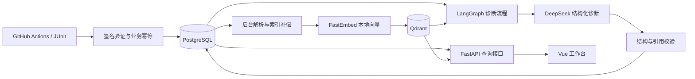

# CI Failure Intelligence

[](https://github.com/LCY-666lll/CI_Failure_Intelligence/actions/workflows/backend-ci.yml)

**面向开发者和测试团队的 CI 失败检索与证据化诊断工作台。**

将 GitHub Actions 的 JUnit 失败报告转为可追溯的错误记录，检索同仓库的相似历史，再根据当前与历史证据生成结构化 AI 诊断。每条诊断引用都可以回到真实失败明细。

**[接入与使用](#接入与使用从这里开始)** · [访问线上工作台](https://cifailure.xyz) · [CI 接入示例](.github/workflows/backend-ci.yml)

> 线上服务已部署，采用邀请制访问。读取令牌由项目所有者单独发放；生成诊断使用独立触发令牌。当前是小规模共享工作区，不提供公开注册、个人账号或仓库级权限隔离。

## 接入与使用：从这里开始

**只想查看已有失败记录？完成第 1、2 步即可。要把自己的 GitHub 仓库接进来？继续完成第 3～5 步。需要生成 AI 诊断时，再做第 6 步。**

使用已上线的服务，只需在自己电脑的浏览器打开网页，不需要下载本项目、启动 Docker，也不需要在本机填写 `.env`。下面先介绍这种用法；想运行自己的实例，请看后面的[本地开发](#本地开发运行自己的实例)。

### 第 1 步：向维护者领取所需凭据

目前没有注册或 GitHub 登录入口。请向项目维护者申请访问；接入仓库前，还需确认维护者允许接收该仓库的失败报告。

| 你要做什么 | 需要领取什么 | 填在哪里 |
|---|---|---|
| 看失败记录、相似历史和已有诊断 | **读取令牌** | 网页入口的“读取令牌”输入框 |
| 让你的 GitHub Actions 发送失败报告 | **CI 接入 HMAC 密钥** | 你的 GitHub 仓库的 Actions Secret `CFI_INGEST_HMAC_SECRET` |
| 手动生成新的 AI 诊断 | **诊断触发令牌**，按授权单独发放 | 事件详情中的“付费诊断触发令牌”输入框 |

三者用途不同，不能互相替代。它们由 CFI 实例维护者配置和发放，**不是 GitHub Personal Access Token**。普通使用者不需要提供自己的 DeepSeek API Key，模型服务由实例维护者配置。

当前共享读取令牌可以查看该实例接入的全部仓库。请先确认报告内容适合在该共享工作区展示，再接入包含内部错误信息的仓库。

### 第 2 步：在浏览器进入工作台

1. 打开 **[https://cifailure.xyz](https://cifailure.xyz)**。
2. 粘贴第 1 步领到的**读取令牌**，点击“**进入工作台**”。
3. 页面显示运行列表后，即可进入某条事件，查看失败明细、相似历史和已有诊断。

读取令牌保存在当前标签页的 `sessionStorage`，刷新可继续使用；点击“断开”或读取接口返回 401 时会清除。重新打开网页时，如果出现令牌输入框，再次输入即可。

**网页能打开不代表已经接入你的仓库。** 此时看到的是该实例已有的记录；下面的 GitHub 配置和 workflow 决定你的报告能否进入这里。

### 第 3 步：在你的 GitHub 仓库配置地址和密钥

进入**要发送失败报告的那个仓库**，打开：

**Settings → Secrets and variables → Actions**

| 选项卡与操作 | Name（名称，原样填写） | Value / Secret（值） |
|---|---|---|
| **Variables → New repository variable** | `CFI_INGEST_URL` | `https://cifailure.xyz/api/v1/ci-runs/ingest` |
| **Secrets → New repository secret** | `CFI_INGEST_HMAC_SECRET` | 第 1 步领取的 **CI 接入 HMAC 密钥** |

地址必须包含完整的 `/api/v1/ci-runs/ingest` 路径。这里不填网页读取令牌，也不填诊断触发令牌。密钥放在 **Secrets**，不放在 Variables、workflow 明文或提交到 Git 的文件中。

如果你只有读取权限、不负责仓库 CI，可以请该仓库维护者完成第 3、4 步。GitHub 的操作说明见[变量配置](https://docs.github.com/en/actions/how-tos/write-workflows/choose-what-workflows-do/use-variables)和[密钥配置](https://docs.github.com/en/actions/how-tos/write-workflows/choose-what-workflows-do/use-secrets)。

### 第 4 步：让 workflow 在测试失败时发送报告

**只添加上面两项配置，还不会自动发送任何数据。** 目标仓库还需要测试报告和发送步骤。

参考本仓库的 [完整 workflow](.github/workflows/backend-ci.yml) 与 [Python 发送脚本](scripts/ci/send_ci_failure.py)，按下面顺序接入目标仓库：

1. 将发送脚本放到目标仓库的 `scripts/ci/send_ci_failure.py`。
2. 在目标仓库的 `.github/workflows/` 中修改现有测试 workflow：让测试命令生成 **JUnit XML**。参考实现使用 pytest，测试步骤的 `id` 为 `backend_tests`，报告输出到 `reports/backend-junit.xml`。
3. 参考 workflow 中测试后的三个步骤：`Upload failed backend test report`、`Check CI failure delivery inputs`、`Send CI failure report`，把它们接到对应测试 Job 中；保证该 Job 能运行 Python 发送脚本。
4. 按目标项目调整下表中的内容，然后提交 workflow 与发送脚本。

| 需要对齐的内容 | 参考实现 | 迁移时怎么改 |
|---|---|---|
| 测试环境与命令 | Python 3.12、uv、`backend/`、pytest | 替换成目标项目实际的依赖安装和测试命令，并产出 JUnit XML |
| 测试步骤身份 | `id: backend_tests` | 若使用其他 ID，同步修改三个后续步骤引用的 `steps.backend_tests.conclusion` |
| 报告路径 | `reports/backend-junit.xml` | 测试输出、artifact 路径、检查文件路径和 `CFI_JUNIT_XML_PATH` 必须指向同一份报告 |
| 运行身份 | `CFI_GITHUB_*` 环境变量 | 保留 workflow 从 `github` 上下文取值的映射；Job 名称按目标 Job 调整，无需到 Settings 手填这些变量 |
| 发送命令 | `uv run --project backend --locked python scripts/ci/send_ci_failure.py` | 参考命令依赖本仓库的 `backend/` 和 uv 配置；目标项目必须改成自己的 Python 运行方式 |

参考 workflow 是本项目后端的 CI，**不能不做适配就当成任意仓库的一键接入文件**。其他测试框架也需要先生成 JUnit XML；当前没有网页上传报告或自动扫描全部 GitHub 仓库的功能。

发送端会读取第 3 步的地址和密钥，连同当前运行身份构造签名请求。参考实现仅在测试步骤失败时投递；fork PR 只保留报告，不使用仓库密钥投递。

### 第 5 步：确认报告已经进来

1. 在目标仓库运行一次**确实产生 JUnit 失败报告**的 CI。测试全部通过时，参考 workflow 不会投递；依赖安装失败、尚未执行测试时，也不能用来验证报告接入。
2. 打开 GitHub 的 **Actions → 对应运行 → 测试 Job**，查看 `Check CI failure delivery inputs` 和 `Send CI failure report`。
3. 发送成功时，日志包含 `原始 CI 失败事件已保存：run_id=... run_attempt=... job_key=...`。这表示平台已接收原始事件，**尚不代表报告已经解析或 AI 诊断已经生成**。
4. 回到网页，点击“**刷新列表**”，按仓库、运行 ID 和 Job 找到这次失败，再进入详情。
5. 新报告可能先显示待解析。后台每轮完成后等待 300 秒；稍后点击“**刷新详情**”，确认能看到测试名称、错误信息和堆栈。首次接入没有相似历史属于正常情况。

到这里，已经完成“GitHub 测试失败 → 签名投递 → 网页查看失败证据”的接入闭环。页面仅展示已投递的失败事件，不会同步仓库的所有提交或成功运行。

### 第 6 步：需要时再触发 AI 诊断

在事件详情的 **AI 诊断**区域查看当前状态。已有诊断可直接阅读；尚未生成时，授权者点击“**使用授权令牌触发诊断**”，输入独立的**诊断触发令牌**，再点击“**确认触发**”。

- **新诊断已完成**：结果已保存，可查看建议及证据引用。
- **已复用已有诊断**：命中有效缓存，本次没有调用模型。
- **已有诊断任务正在处理中**：页面自动查询结果，本次不会重复启动生成。

报告自动解析和索引不会自动触发付费诊断。生成新诊断可能产生模型费用；触发令牌仅临时保存在页面内存中。点击诊断中的当前或历史证据引用，可以回到对应失败位置。

### 卡在哪一步，先看这里

| 现象 | 优先检查 |
|---|---|
| 网页能打开，但提示读取令牌无效 | 是否使用该实例维护者发放的读取令牌，而非 HMAC 密钥或触发令牌 |
| GitHub 已配置变量，但页面没有新记录 | workflow 是否接上发送步骤；测试是否真的失败并生成 JUnit；发送步骤是否执行成功 |
| GitHub 提示缺少配置 | 配置是否加在目标仓库；地址是否在 Variables、密钥是否在 Secrets；名称是否完全一致 |
| 投递返回 401 | HMAC 密钥是否与目标实例一致、请求时间是否正常；网页读取令牌不能用于投递 |
| 发送成功，但详情仍在等待解析 | 原始接收与后台解析是两个阶段，等待后刷新详情；持续不变时联系实例维护者检查后台 |
| 有失败明细，但没有 AI 诊断 | 需要持有独立触发令牌的授权者主动确认生成 |

## 可以做什么

- **接收真实 CI 失败**：GitHub Actions 发送 JUnit 报告，服务端验证 HMAC、时间戳、nonce 和请求大小，并处理业务重复提交。
- **保留结构化证据**：安全解析 JUnit 的 failure/error，保存测试名称、错误消息、堆栈与运行身份，明确区分待解析、解析成功和解析失败。
- **检索相似历史**：FastEmbed 在本地生成向量，Qdrant 按同仓库与历史时间边界检索，候选经 PostgreSQL 回查和内容核对后展示，最多返回 5 条。
- **生成有来源的诊断**：LangGraph 编排证据读取、历史检索、缓存与租约、DeepSeek 调用和结果写回；校验结构化输出及每条证据引用。
- **控制重复调用**：已有有效诊断默认复用；处理中请求不会重复启动生成；读取已有结果不调用付费模型。
- **在页面完成调查**：Vue 工作台展示事件、失败详情、相似历史和诊断；引用可跳转来源事件并自动展开对应证据。
- **自动处理新报告**：后端启动先处理一轮，随后每轮结束等待 300 秒，串行完成待解析报告、增量索引及索引补偿。

## 一次失败怎样进入工作台



PostgreSQL 是业务事实来源，Qdrant 是可重建的检索索引；历史候选必须回到数据库核实。Redis 负责 nonce 防重放等短期状态。AI 提供基于证据的建议，鉴权、状态、幂等和引用真实性由程序校验。

缓存命中和已有任务处理中时，诊断流程直接返回，不进入付费模型节点。历史检索不可用时可以降级使用当前证据，页面会明确显示检索状态。相似分数用于排序，不代表根因概率。

## 技术栈

| 层次 | 技术与职责 |
|---|---|
| 前端 | Vue 3、Vue Router、Vite；事件调查与证据导航 |
| HTTP API | Python 3.12、FastAPI、Pydantic；请求契约、鉴权和响应 |
| 业务数据 | PostgreSQL、SQLAlchemy async、Psycopg、Alembic |
| 历史检索 | Qdrant、FastEmbed；同仓库 dense 向量检索 |
| 诊断流程 | LangGraph、LangChain、DeepSeek；结构化生成、缓存与租约 |
| 接入安全 | HMAC、timestamp、nonce、Redis；签名验证与防重放 |
| 工程 | uv、pytest、Docker Compose、GitHub Actions |

## HTTP 接口

线上接口使用 `https://cifailure.xyz` 作为根地址。

| 方法 | 路径 | 用途 | 认证 |
|---|---|---|---|
| POST | `/api/v1/ci-runs/ingest` | 接收 CI 失败报告 | HMAC + timestamp + nonce |
| GET | `/api/v1/ci-runs?limit=20` | 最近事件，limit 为 1–100 | 读取 Bearer 令牌 |
| GET | `/api/v1/ci-runs/{event_id}/failures` | 解析状态与失败明细 | 读取 Bearer 令牌 |
| GET | `/api/v1/ci-runs/{event_id}/history` | 历史来源与检索状态 | 读取 Bearer 令牌 |
| GET | `/api/v1/ci-runs/{event_id}/diagnosis` | 已保存诊断和任务状态 | 读取 Bearer 令牌 |
| POST | `/api/v1/ci-runs/{event_id}/diagnosis` | 生成、复用或返回处理中状态 | 独立触发 Bearer 令牌 |
| GET | `/health/live` | 进程存活检查 | 无 |

`event_id` 是平台内部事件主键，不是 GitHub 的 `run_id`。诊断 GET 返回 `not_started / processing / completed / failed`；诊断 POST 返回 `generated / cached / in_progress`。历史的 `available / not_ready / degraded / disabled` 应与结果列表一起解释，不能把检索故障显示成“没有历史”。

## 本地开发：运行自己的实例

这一节供修改代码或运行独立实例的人使用。仅使用线上工作台的受邀用户，完成前面的“接入与使用”即可。

本地网页默认请求本地后端，**不会因为输入线上令牌就连接线上服务**。本地运行时，网页读取令牌、诊断触发令牌与 GitHub 投递密钥都要对应这套本地后端的配置，分别为 `CFI_FAILURE_READ_TOKEN`、`CFI_AI_DIAGNOSIS_TRIGGER_TOKEN`、`CFI_INGEST_HMAC_SECRET`。仅启动前端无法提供完整功能。

GitHub 托管 Runner 无法访问你电脑上的 `127.0.0.1:8002`；要接收它的报告，目标实例必须有 Runner 可访问的地址。使用线上实例时保持第 3 步的 HTTPS 地址；自行部署时由维护者提供自己的接入地址和凭据。

前提：Python 3.12、uv、Node.js 24、npm 与 Docker Compose。配置示例见 [`.env.example`](.env.example)，前端开发说明见 [`frontend/README.md`](frontend/README.md)。

后端运行依赖 PostgreSQL、Redis、Qdrant、本地 Embedding 模型缓存和 DeepSeek 配置。首次准备还包括数据库应用账号、Alembic 迁移、Redis 凭据和 ACL；模型缓存需提前准备，在线请求不会自动下载模型。

**已有上述本地配置时**，可使用仓库内 Compose 构建并启动后端：

```powershell
docker compose build backend
docker compose up -d --wait backend
```

本地后端为 `http://127.0.0.1:8002`，健康检查为 `/health/live`。Redis 新进程有防重放预热要求，刚启动时报告接入可能暂时返回 503。

前端在 `frontend/` 下运行：

```powershell
cd frontend
npm ci
npm run dev -- --host 127.0.0.1
```

打开终端给出的地址；Vite 将 `/api` 代理到本地 8002。生产环境使用构建后的静态文件和 HTTPS 反向代理，不运行 Vite 开发服务器。仓库根目录的 Compose 是本地基础配置，不是包含域名、TLS 和前端发布的一键公网部署脚本。

## 验证与当前状态

已完成后端核心链路、前端历史展示与引用跳转，并已部署公网工作台。2026-11-15 的公网 HTTP 验收覆盖：

- 可信 HTTPS、HTTP 跳转、静态资源与深层页面路由。
- 读取权限及 401 / 404 / 422 边界。
- HMAC 接入、原样重放拒绝、业务重试幂等与内容冲突。
- 云端自动解析，以及同仓库历史命中、排除当前事件和其他仓库。
- 一次真实结构化诊断、持久化读取、缓存复用与证据引用。

本次公网投递证据来自通过 HTTPS 发送的受控验收报告；**GitHub 托管 Runner 向正式域名的投递需单独实测**。该公网验收不等于持续负载压测、故障恢复或高并发容量承诺。

开发验证命令：

```powershell
# 仓库根目录：后端测试，包含发送端测试
uv run --project backend pytest backend/tests -q

# frontend/ 目录：请求契约与引用解析测试、生产构建
npm test
npm run build
```

需要外部环境的真实集成测试可能跳过；跳过不算通过。现有 Backend CI 运行后端测试，前端测试和构建需单独执行。

## 仓库结构

```text
backend/        FastAPI、业务服务、模型与存储适配、迁移和测试
frontend/       Vue 工作台、请求封装、证据导航和前端测试
scripts/ci/     GitHub Actions 的失败报告发送端
.github/        CI workflow
infra/redis/    Redis 运行配置
compose.yaml    本地基础设施与后端服务
Dockerfile      后端生产依赖镜像
.env.example    不含真实凭据的配置模板
```

当前范围聚焦小规模团队的失败调查闭环。个人账号、仓库级 RBAC、多租户、复杂聚类、reranker、多 Agent、自动修改代码和 Kubernetes 不在当前实现范围内。
