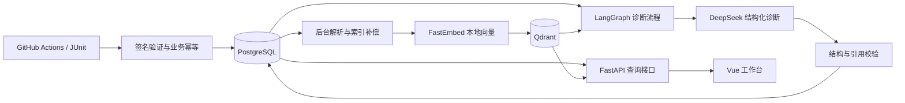

# CI Failure Intelligence

[](https://github.com/LCY-666lll/CI_Failure_Intelligence/actions/workflows/backend-ci.yml)

**面向开发者和测试团队的 CI 失败检索与证据化诊断工作台。**

将 GitHub Actions 的 JUnit 失败报告转为可追溯的错误记录，检索同仓库的相似历史，再根据当前与历史证据生成结构化 AI 诊断。每条诊断引用都可以回到真实失败明细。

**[访问线上工作台](https://cifailure.xyz)** · [前端说明](frontend/README.md) · [CI 接入示例](.github/workflows/backend-ci.yml)

> 线上服务已部署，采用邀请制访问。读取令牌由项目所有者单独发放；生成诊断使用独立触发令牌。当前是小规模共享工作区，不提供公开注册、个人账号或仓库级权限隔离。

## 可以做什么

- **接收真实 CI 失败**：GitHub Actions 发送 JUnit 报告，服务端验证 HMAC、时间戳、nonce 和请求大小，并处理业务重复提交。
- **保留结构化证据**：安全解析 JUnit 的 failure/error，保存测试名称、错误消息、堆栈与运行身份，明确区分待解析、解析成功和解析失败。
- **检索相似历史**：FastEmbed 在本地生成向量，Qdrant 按同仓库与历史时间边界检索，候选经 PostgreSQL 回查和内容核对后展示，最多返回 5 条。
- **生成有来源的诊断**：LangGraph 编排证据读取、历史检索、缓存与租约、DeepSeek 调用和结果写回；校验结构化输出及每条证据引用。
- **控制重复调用**：已有有效诊断默认复用；处理中请求不会重复启动生成；读取已有结果不调用付费模型。
- **在页面完成调查**：Vue 工作台展示事件、失败详情、相似历史和诊断；引用可跳转来源事件并自动展开对应证据。
- **自动处理新报告**：后端启动先处理一轮，随后每轮结束等待 300 秒，串行完成待解析报告、增量索引及索引补偿。

## 一次失败怎样进入工作台



PostgreSQL 是业务事实来源，Qdrant 是可重建的检索索引；历史候选必须回到数据库核实。Redis 负责 nonce 防重放等短期状态。AI 提供基于证据的建议，鉴权、状态、幂等和引用真实性由程序校验。

缓存命中和已有任务处理中时，诊断流程直接返回，不进入付费模型节点。历史检索不可用时可以降级使用当前证据，页面会明确显示检索状态。相似分数用于排序，不代表根因概率。

## 技术栈

| 层次 | 技术与职责 |
|---|---|
| 前端 | Vue 3、Vue Router、Vite；事件调查与证据导航 |
| HTTP API | Python 3.12、FastAPI、Pydantic；请求契约、鉴权和响应 |
| 业务数据 | PostgreSQL、SQLAlchemy async、Psycopg、Alembic |
| 历史检索 | Qdrant、FastEmbed；同仓库 dense 向量检索 |
| 诊断流程 | LangGraph、LangChain、DeepSeek；结构化生成、缓存与租约 |
| 接入安全 | HMAC、timestamp、nonce、Redis；签名验证与防重放 |
| 工程 | uv、pytest、Docker Compose、GitHub Actions |

## 访问与使用

1. 打开 [cifailure.xyz](https://cifailure.xyz)，输入项目所有者提供的**读取令牌**。
2. 从运行列表进入事件详情，查看失败证据及相似历史。
3. 阅读已有诊断，点击当前或历史引用回到对应错误位置。
4. 仅在需要时，由持有**诊断触发令牌**的授权者确认生成；该操作可能产生模型费用。

读取令牌保存在当前标签页的 `sessionStorage` 中，刷新可继续使用；点击“断开”或读取鉴权失败后清除。诊断触发令牌仅临时保存在内存中。两类访问令牌、CI 接入 HMAC 密钥和 DeepSeek API Key 各有独立用途，不应混用。

共享读取令牌可查看当前部署接入的全部仓库。仓库名称展示与检索过滤不等于用户权限隔离。

## HTTP 接口

线上接口使用 `https://cifailure.xyz` 作为根地址。

| 方法 | 路径 | 用途 | 认证 |
|---|---|---|---|
| POST | `/api/v1/ci-runs/ingest` | 接收 CI 失败报告 | HMAC + timestamp + nonce |
| GET | `/api/v1/ci-runs?limit=20` | 最近事件，limit 为 1–100 | 读取 Bearer 令牌 |
| GET | `/api/v1/ci-runs/{event_id}/failures` | 解析状态与失败明细 | 读取 Bearer 令牌 |
| GET | `/api/v1/ci-runs/{event_id}/history` | 历史来源与检索状态 | 读取 Bearer 令牌 |
| GET | `/api/v1/ci-runs/{event_id}/diagnosis` | 已保存诊断和任务状态 | 读取 Bearer 令牌 |
| POST | `/api/v1/ci-runs/{event_id}/diagnosis` | 生成、复用或返回处理中状态 | 独立触发 Bearer 令牌 |
| GET | `/health/live` | 进程存活检查 | 无 |

`event_id` 是平台内部事件主键，不是 GitHub 的 `run_id`。诊断 GET 返回 `not_started / processing / completed / failed`；诊断 POST 返回 `generated / cached / in_progress`。历史的 `available / not_ready / degraded / disabled` 应与结果列表一起解释，不能把检索故障显示成“没有历史”。

## GitHub Actions 接入

现有参考实现包含 [后端 workflow](.github/workflows/backend-ci.yml) 和 [Python 发送端](scripts/ci/send_ci_failure.py)。接入仓库需要：

| GitHub 配置 | 值 |
|---|---|
| Repository Variable `CFI_INGEST_URL` | `https://cifailure.xyz/api/v1/ci-runs/ingest`，或自建实例对应地址 |
| Repository Secret `CFI_INGEST_HMAC_SECRET` | 与目标实例约定的接入 HMAC 密钥 |

Workflow 在测试失败时保存 JUnit artifact，并向发送端提供报告路径、仓库 ID、运行 ID、重跑次数、Job、提交和分支信息。发送端负责构造签名信封和有限重试。复用到其他项目时，需要适配测试命令及 JUnit 路径；fork PR 默认只保留报告，不使用仓库密钥投递。

当前接入以已采集的失败 CI 运行作为数据来源，不会自动同步 GitHub 全部提交或成功运行。

## 本地开发

前提：Python 3.12、uv、Node.js 24、npm 与 Docker Compose。配置示例见 [`.env.example`](.env.example)，前端开发说明见 [`frontend/README.md`](frontend/README.md)。

后端运行依赖 PostgreSQL、Redis、Qdrant、本地 Embedding 模型缓存和 DeepSeek 配置。首次准备还包括数据库应用账号、Alembic 迁移、Redis 凭据和 ACL；模型缓存需提前准备，在线请求不会自动下载模型。

**已有上述本地配置时**，可使用仓库内 Compose 构建并启动后端：

```powershell
docker compose build backend
docker compose up -d --wait backend
```

本地后端为 `http://127.0.0.1:8002`，健康检查为 `/health/live`。Redis 新进程有防重放预热要求，刚启动时报告接入可能暂时返回 503。

前端在 `frontend/` 下运行：

```powershell
cd frontend
npm ci
npm run dev -- --host 127.0.0.1
```

打开终端给出的地址；Vite 将 `/api` 代理到本地 8002。生产环境使用构建后的静态文件和 HTTPS 反向代理，不运行 Vite 开发服务器。仓库根目录的 Compose 是本地基础配置，不是包含域名、TLS 和前端发布的一键公网部署脚本。

## 验证与当前状态

已完成后端核心链路、前端历史展示与引用跳转，并已部署公网工作台。2026-11-15 的公网 HTTP 验收覆盖：

- 可信 HTTPS、HTTP 跳转、静态资源与深层页面路由。
- 读取权限及 401 / 404 / 422 边界。
- HMAC 接入、原样重放拒绝、业务重试幂等与内容冲突。
- 云端自动解析，以及同仓库历史命中、排除当前事件和其他仓库。
- 一次真实结构化诊断、持久化读取、缓存复用与证据引用。

本次公网投递证据来自通过 HTTPS 发送的受控验收报告；**GitHub 托管 Runner 向正式域名的投递需单独实测**。该公网验收不等于持续负载压测、故障恢复或高并发容量承诺。

开发验证命令：

```powershell
# 仓库根目录：后端测试，包含发送端测试
uv run --project backend pytest backend/tests -q

# frontend/ 目录：请求契约与引用解析测试、生产构建
npm test
npm run build
```

需要外部环境的真实集成测试可能跳过；跳过不算通过。现有 Backend CI 运行后端测试，前端测试和构建需单独执行。

## 仓库结构

```text
backend/        FastAPI、业务服务、模型与存储适配、迁移和测试
frontend/       Vue 工作台、请求封装、证据导航和前端测试
scripts/ci/     GitHub Actions 的失败报告发送端
.github/        CI workflow
infra/redis/    Redis 运行配置
compose.yaml    本地基础设施与后端服务
Dockerfile      后端生产依赖镜像
.env.example    不含真实凭据的配置模板
```

当前范围聚焦小规模团队的失败调查闭环。个人账号、仓库级 RBAC、多租户、复杂聚类、reranker、多 Agent、自动修改代码和 Kubernetes 不在当前实现范围内。
