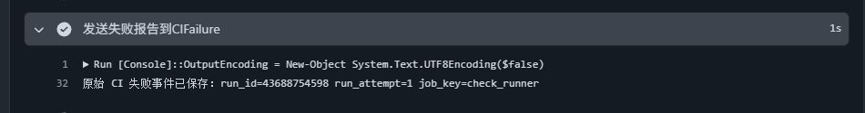

# 把 GitHub Actions 失败报告接入 CFI

[返回产品介绍](../README.md#接入与使用)

这份说明面向负责目标仓库 CI 的维护者。先在目标仓库配置 `CFI_INGEST_URL`（Variable）和 `CFI_INGEST_HMAC_SECRET`（Secret），见 [README 第 3 步](../README.md#3-在你的-github-仓库填两项配置)。

## 1. 放入发送脚本

将 [send_ci_failure.py](../scripts/ci/send_ci_failure.py) 复制到**目标仓库**的 `scripts/ci/send_ci_failure.py`。脚本仅使用 Python 标准库；发送端需要能运行 Python，本例使用 3.12。

## 2. 找到生成 JUnit 的测试步骤

下面以已有 pytest 项目为例。在原有依赖安装完成后，为测试步骤设置 `id: tests`，并输出 JUnit：

```yaml
- name: Run tests
  id: tests
  run: python -m pytest --junitxml=reports/junit.xml
```

这是对已有测试步骤的示例修改，不是可单独运行的完整 workflow。Java、JavaScript 等项目保留自己的测试环境和命令，只需让测试工具输出 JUnit XML，并记住报告路径。

## 3. 在同一个 Job 的测试步骤后追加发送步骤

将下面两步放到现有 workflow 的 `jobs.<你的 Job>.steps` 中，测试步骤之后。保留你已有的 checkout、运行环境与依赖安装步骤。

```yaml
- name: Set up Python for CFI sender
  if: >-
    failure() && steps.tests.conclusion == 'failure' &&
    (github.event_name != 'pull_request' || github.event.pull_request.head.repo.fork == false)
  uses: actions/setup-python@5fda3b95a4ea91299a34e894583c3862153e4b97 # v7.0.0
  with:
    python-version: '3.12'

- name: Send failure report to CFI
  if: >-
    failure() && steps.tests.conclusion == 'failure' &&
    (github.event_name != 'pull_request' || github.event.pull_request.head.repo.fork == false)
  env:
    CFI_INGEST_URL: ${{ vars.CFI_INGEST_URL }}
    CFI_INGEST_HMAC_SECRET: ${{ secrets.CFI_INGEST_HMAC_SECRET }}
    CFI_JUNIT_XML_PATH: reports/junit.xml
    CFI_GITHUB_REPOSITORY_ID: ${{ github.repository_id }}
    CFI_GITHUB_REPOSITORY: ${{ github.repository }}
    CFI_GITHUB_RUN_ID: ${{ github.run_id }}
    CFI_GITHUB_RUN_ATTEMPT: ${{ github.run_attempt }}
    CFI_GITHUB_WORKFLOW_NAME: ${{ github.workflow }}
    CFI_GITHUB_JOB_KEY: ${{ github.job }}
    CFI_GITHUB_JOB_NAME: ${{ github.job }}
    CFI_GITHUB_COMMIT_SHA: ${{ github.sha }}
    CFI_GITHUB_HEAD_BRANCH: ${{ github.head_ref || github.ref_name }}
  run: python scripts/ci/send_ci_failure.py
```

复制后只需对齐以下内容：

| 内容 | 必须保持一致 |
|---|---|
| 测试步骤 ID | 如果原步骤不是 `tests`，将两处 `steps.tests.conclusion` 改成实际 ID |
| 报告路径 | `CFI_JUNIT_XML_PATH` 指向实际生成的 JUnit 文件；多报告项目先选择要接入的报告 |
| 工作目录 | 示例按仓库根目录执行；若设置过 `defaults.run.working-directory`，请按实际执行目录调整脚本与报告路径 |
| 提交身份 | 示例使用 checkout 默认的 `github.sha`；若自定义 checkout 到另一提交，应传入实际被测试的完整提交 SHA |

`CFI_GITHUB_*` 值来自 GitHub 运行上下文，不用在仓库 Settings 中手动创建。HMAC 密钥只从 Secret 读取，不要粘贴进 YAML。

仅测试失败时发送，fork PR 不发送。依赖安装失败而测试没有执行、测试被取消或没有 JUnit 文件时，不能据此完成报告接入验收。可另行参照本项目的 [完整 workflow](../.github/workflows/backend-ci.yml) 保留失败报告 artifact；该文件含本项目的 uv/backend 目录配置，迁移时不要原样覆盖目标项目的测试流程。

## 4. 确认接入

提交脚本和 workflow，运行一次产生 JUnit 的失败测试。在 **Actions → 对应运行 → Job → Send failure report to CFI** 中看到“原始 CI 失败事件已保存”，表示接收完成。测试 Job 保留失败状态是正常现象。



回到 CFI 刷新运行列表，按仓库、运行 ID 与 Job 找到事件。接收、后台解析和授权生成诊断是三个阶段；后续网页操作见 [README 第 5、6 步](../README.md#5-确认投递在网页查看失败)。
